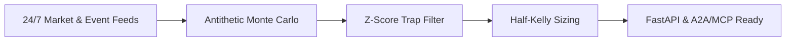

# AevumQ RWA & Event Quantitative Engine (Lite Demo)

Self-hosted quantitative risk, regime-tension, and variance-reduced simulation toolkit designed for 24/7 tokenized real-world assets (RWA) and event-probability data feeds.

## Architecture Overview



## Quickstart (Lite Version)

```bash
pip install numpy
python demo_lite.py
```

## Full Production Release (v1.0 — Full Source Code + Dashboard)

Upgrade to the complete standalone engine including:
- **20,000-Path Antithetic Monte Carlo & Lookback Tension Engine**
- **Automated Top-Bubble Trap Filter (`Z > 2.5`) & Fractional Kelly Sizing**
- **Full FastAPI Server (`app.py`) + Dark-Mode Dashboard (`landing.html`) + A2A/MCP Endpoints**

👉 **[Get Full Source Code & One-Time License ($49) on Polar.sh](https://polar.sh)**

---
*Disclaimer: Provided strictly "as-is" for informational, research, and engineering purposes only. Not affiliated with any third-party exchange or protocol. Does not constitute financial or investment advice.*
